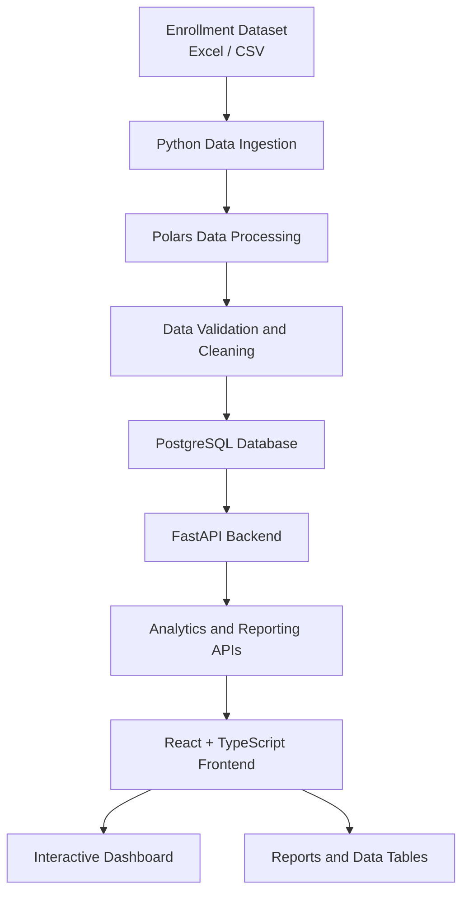

# Enrollment Analytics and Reporting System (EDARS)

An academic data analytics and reporting platform designed to transform enrollment records into meaningful insights through data processing, centralized storage, analytics APIs, and interactive dashboards.

## Project Overview

The **Enrollment Analytics and Reporting System (EDARS)** is a data-driven platform that helps academic institutions analyze student enrollment information and monitor academic performance.

The system focuses on data analytics and reporting rather than managing the actual student enrollment process. It organizes enrollment data, calculates key performance indicators (KPIs), and presents insights through an interactive dashboard.

## Key Features

- **Enrollment Overview** – Displays important enrollment statistics and KPIs.
- **Enrollment Analytics** – Provides access to student enrollment records and related statistics.
- **Program Analytics** – Presents enrollment information by academic program.
- **Campus Analytics** – Summarizes enrollment information across campuses.
- **Academic Period Analytics** – Analyzes enrollment records by academic year and trimester.
- **Reports** – Provides consolidated enrollment reports and summaries.
- **User Management** – Supports administrative management of system users.
- **Authentication** – Provides account registration and sign-in functionality.
- **Password Recovery** – Supports email-based verification and password resetting.
- **Interactive Dashboard** – Displays enrollment insights through charts, tables, and KPI cards.

## Technology Stack

| Category | Technologies |
|---|---|
| Programming Language | Python, TypeScript |
| Backend Framework | FastAPI |
| Frontend Framework | React |
| Frontend Build Tool | Vite |
| Styling | Tailwind CSS |
| Data Processing | Polars |
| Database | PostgreSQL |
| Database Toolkit | SQLAlchemy |
| Data Visualization | Recharts |
| Python Package Manager | uv |
| API Testing | Postman |
| Version Control | Git and GitHub |

## System Architecture

The system follows a data engineering and analytics workflow.



### Data Pipeline

1. **Extraction** – Reads enrollment records from the source dataset.
2. **Transformation** – Uses Polars to clean, standardize, and prepare enrollment data.
3. **Validation** – Checks the processed records for data quality issues.
4. **Loading** – Stores the processed records in PostgreSQL.
5. **Analytics** – Uses SQL and Python services to calculate enrollment statistics.
6. **Visualization** – Presents the results through the React dashboard.

## Dashboard Modules

| Module | Description |
|---|---|
| Overview | Displays enrollment KPIs and visual summaries. |
| Enrollments | Displays student enrollment records. |
| Programs | Provides program-level enrollment analytics. |
| Campuses | Provides campus-level enrollment analytics. |
| Academic Periods | Displays enrollment statistics by academic period. |
| Reports | Presents consolidated analytics and reports. |
| User Management | Manages system user accounts. |

## Project Structure

```text
enrollment-analytics/
│
├── backend/
│   └── app/
│       ├── api/
│       │   └── routes/
│       ├── core/
│       ├── schemas/
│       └── services/
│
├── ingestion/
│   ├── extract.py
│   ├── transform.py
│   ├── load.py
│   └── pipeline.py
│
├── analytics/
│   └── services/
│
├── data/
│   └── source/
│
├── frontend/
│   ├── src/
│   │   ├── components/
│   │   ├── services/
│   │   ├── types/
│   │   ├── App.tsx
│   │   └── index.css
│   └── package.json
│
├── tests/
├── .env.example
├── pyproject.toml
├── uv.lock
└── README.md
```

*The structure above is a high-level representation. Adjust it to match the final repository.*

## Installation and Setup

### Prerequisites

Make sure the following tools are installed:

- Python 3.14 or a compatible project-supported version
- uv
- Node.js and npm
- PostgreSQL
- Git

### 1. Clone the Repository

```bash
git clone https://github.com/YOUR_USERNAME/enrollment-analytics.git

cd enrollment-analytics
```

### 2. Install Backend Dependencies

```bash
uv sync
```

### 3. Configure Environment Variables

Create a `.env` file using `.env.example` as a reference.

Configure the required database connection, authentication settings, and email service settings.

**Important:** Never commit your `.env` file, passwords, API keys, or other credentials to GitHub.

### 4. Prepare the Database

Create the PostgreSQL database and configure the connection settings according to your project configuration.

Run the data ingestion pipeline:

```bash
uv run python -m ingestion.pipeline
```

### 5. Start the Backend

Use the backend entry point configured in your project:

```bash
uv run uvicorn backend.app.main:app --reload --host 0.0.0.0 --port 8000
```

Backend API:

```text
http://localhost:8000
```

API documentation:

```text
http://localhost:8000/docs
```

### 6. Install Frontend Dependencies

Open another terminal:

```bash
cd frontend
npm install
```

### 7. Start the Frontend

```bash
npm run dev
```

Frontend:

```text
http://localhost:5173
```

## API

The backend provides REST API endpoints for authentication, enrollment analytics, and reporting.

API prefix:

```text
/api/v1
```

Explore the available endpoints through FastAPI Swagger documentation:

```text
http://localhost:8000/docs
```

## Security

- Authenticated access to protected resources.
- Role-based access control where configured.
- Password hashing.
- Email-based password recovery.
- Environment-based configuration.
- Sensitive credentials excluded from version control.

## Data and Privacy

The project uses enrollment datasets for analytics and reporting. Use synthetic or properly authorized, anonymized data when demonstrating or publishing the project.

Do not upload real student personal information, credentials, or private institutional records to a public repository.

## Project Goals

This project demonstrates practical skills in:

- Data ingestion and ETL development.
- Data cleaning and validation using Polars.
- Relational database design and SQL.
- Backend API development using FastAPI.
- Frontend development using React and TypeScript.
- Data visualization and analytics.
- Authentication and application security.
- Integrating data engineering workflows with analytics applications.

## Future Improvements

- Implement a dimensional data warehouse using a star schema.
- Introduce dbt for data transformation and modeling.
- Add Airflow for scheduled pipeline orchestration.
- Add automated data quality tests.
- Implement automated report exports.
- Improve deployment and CI/CD workflows.
- Add cloud storage integration for raw datasets.

## Project Status

**Development Version**

This project is actively being developed as an academic project and data engineering portfolio.

## Author

**Your Name**

GitHub: [YOUR_GITHUB_USERNAME](https://github.com/alaldwin)

---

*Enrollment Analytics and Reporting System — Turning enrollment data into meaningful academic insights.*